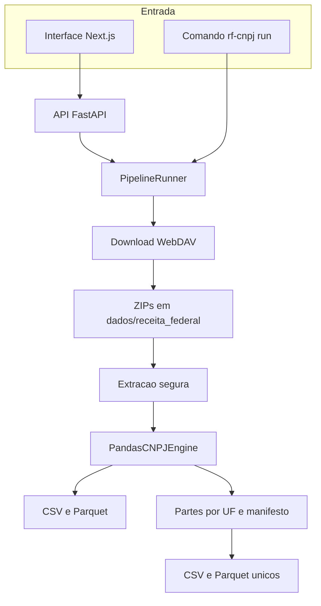

# RF CNPJ

Pipeline local para baixar os dados públicos de CNPJ da Receita Federal, cruzar as tabelas escolhidas e exportar CSV e Parquet.

## Contexto

A Receita Federal publica, todo mês, os dados abertos de CNPJ em vários ZIPs: estabelecimentos, empresas, sócios e tabelas de domínio (CNAE, natureza jurídica, municípios e outras). Consultar um município, uma UF ou o país inteiro exige baixar esses arquivos, extrair, traduzir códigos e juntar as tabelas.

Este repositório faz esse trabalho na máquina de quem executa o projeto. A interface e a API sobem em localhost e os arquivos ficam em disco.

## O que o projeto faz

- Baixa os ZIPs do compartilhamento público da Receita Federal via WebDAV.
- Descobre os meses disponíveis nesse compartilhamento.
- Extrai os ZIPs e rejeita caminhos que tentam sair da pasta de destino.
- Cruza estabelecimentos com empresas e com as tabelas auxiliares escolhidas.
- Agrega sócios em uma linha por CNPJ.
- Exporta o mesmo resultado em CSV (UTF-8 com BOM) e Parquet.
- Processa um município, uma UF ou o Brasil inteiro. No Brasil inteiro, o processamento percorre as 27 UFs e grava um checkpoint por UF concluída.
- Oferece interface Next.js, API FastAPI e o comando `rf-cnpj run`.
- Pode apagar só os arquivos extraídos, ou também os ZIPs, depois da exportação.

O campo `EMAIL` da saída vem do estabelecimento. A base pública não inclui e-mail pessoal de sócio.

Tempo de execução estimado neste projeto: cerca de 1h30 a 2h para uma UF inteira, somando download, processamento e exportação, conforme a conexão e o hardware. O Brasil inteiro percorre as 27 UFs em sequência e pode levar várias horas. Se a execução cair, rode de novo com o mesmo mês e a mesma saída para continuar das UFs já gravadas no manifesto.

## Stack

- Python 3.10+
- pandas e PyArrow, com leitura em chunks
- FastAPI e Uvicorn
- Requests para o WebDAV da Receita Federal
- Next.js 16, React 19, Tailwind CSS e shadcn/ui

## Arquitetura



A API monta um `RunConfig` e chama `PipelineRunner`. O runner baixa, extrai, processa, exporta e limpa. A engine Pandas é a implementação atual e entra no runner por parâmetro.

No escopo Brasil, o download ocorre uma vez. Cada UF é processada com a engine atual, gravada em `<nome>.parts/` e registrada em `<nome>.manifest.json` só depois que o CSV e o Parquet daquela UF ficam completos. Uma UF interrompida no meio fica de fora do manifesto e é refeita na próxima execução. No fim, as partes são unidas em um CSV e um Parquet.

## Como rodar localmente

Requisitos: Python 3.10 ou superior, Node.js e npm.

```bash
python -m venv .venv
source .venv/bin/activate
pip install -r requirements.txt
pip install .
cp .env.example .env
```

No Windows, ative o ambiente com `.venv\Scripts\activate`.

Preencha `RF_NEXTCLOUD_SHARE_TOKEN` no `.env`. O valor é o identificador público do compartilhamento de dados abertos de CNPJ, o trecho final da URL `index.php/s/<identificador>`. A página de orientação da Receita Federal está em:

https://www.gov.br/receitafederal/pt-br/assuntos/orientacao-tributaria/cadastros/consultas/dados-publicos-cnpj

O download e a listagem de meses leem o `.env` da raiz. Variável já definida no shell tem prioridade sobre o arquivo.

| Variável | Obrigatória | Uso |
| --- | --- | --- |
| `RF_NEXTCLOUD_SHARE_TOKEN` | sim, para baixar arquivos e listar meses | Identificador público do compartilhamento WebDAV |
| `RF_NEXTCLOUD_WEBDAV_URL` | não | Endpoint WebDAV. Vazia usa o endpoint público da Receita Federal |
| `NEXT_PUBLIC_RF_CNPJ_API_URL` | não | URL da API vista pelo frontend. Padrão `http://127.0.0.1:8000`. O Next.js lê essa variável em `web/.env.local` |

Para apontar o frontend a outra API:

```bash
cp web/.env.example web/.env.local
```

Instale o frontend:

```bash
cd web
npm install
```

Abra dois terminais na raiz do repositório.

Terminal 1, API local:

```bash
rf-cnpj api
```

Terminal 2, interface:

```bash
rf-cnpj web
```

Se `rf-cnpj` não estiver no PATH:

```bash
python -m rf_cnpj api
python -m rf_cnpj web
```

Sem instalar o pacote Python:

```bash
python -m uvicorn rf_cnpj.api.app:app --reload
```

e, na pasta `web`, `npm run dev`.

Abra `http://localhost:3000`. Na interface, escolha o mês, o escopo (Brasil, UF ou município), as tabelas auxiliares, os diretórios de dados e de saída, e a política de limpeza.

Execução sem interface:

```bash
rf-cnpj run --month 2026-01 --scope uf --uf PE --data-dir dados --output-dir saida
```

`--scope` aceita `brasil`, `uf` e `municipio`. Para município, informe também `--municipio`. `--tables` recebe zero ou mais rótulos, e o padrão é incluir todas: `CNAEs`, `Simples/MEI`, `Motivos`, `Naturezas Juridicas`, `Qualificacoes`, `Paises`, `Socios/QSA`. `--cleanup` aceita `none`, `extracted` e `all_raw`.

A saída fica em `saida/`:

- `<nome>.csv`
- `<nome>.parquet`

Durante o escopo Brasil também aparecem `<nome>.parts/` e `<nome>.manifest.json`. Esses arquivos temporários saem depois do merge.

## Estrutura

```text
rf_cnpj/
  api/         # FastAPI: opções, jobs e eventos da execução
  app/         # pacote de interface local; a UI atual está em web/
  core/        # download, meses, extração, schemas, normalização e exportação
  engines/     # engine Pandas em chunks
  cli.py       # comandos api, web e run
web/           # interface Next.js e shadcn/ui
tests/         # testes com fixtures pequenas
docs/superpowers/  # specs e planos de desenho
pyproject.toml
requirements.txt
.env.example
```

O Git ignora `dados/`, `saida/`, `.venv/`, `.env` e arquivos de credencial. `.env.example` permanece no repositório, só com nomes de variáveis.

## Limites atuais

- A engine segura em memória os estabelecimentos do escopo filtrado. O Brasil inteiro é processado UF a UF por esse motivo.
- Geocodificação não faz parte do núcleo.
- A lista de municípios da interface usa o CSV público `municipios.csv` da Receita Federal, separado dos ZIPs do mês.

## Próximos passos possíveis

- Trocar a engine Pandas por outra, como DuckDB, que processe o país sem o loop por UF. `PipelineRunner` já recebe a engine por parâmetro.
- Incluir geocodificação depois da exportação.
- Acrescentar um teste de integração com um mês pequeno já presente em disco, sem chamada de rede.

## Desenvolvimento

Backend:

```bash
python -m pytest -q
```

Frontend:

```bash
cd web
npm run lint
npm run build
```
